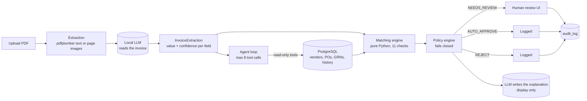

# TriMatch: AI Invoice Reconciliation Agent

TriMatch handles supplier invoices the way an accounts-payable team does. A user uploads an invoice PDF; a local language model **reads** it into structured fields; an agent gathers the matching purchase order, goods receipts and history through read-only tools; a deterministic rules engine performs a **three-way match** (what we ordered, what we received, what we are billed for); and a policy engine returns `AUTO_APPROVE`, `NEEDS_REVIEW` or `REJECT` with a plain-English explanation. Anything uncertain goes to a human review screen, and every step is audit-logged.

It is built for finance and accounts-payable teams that process hundreds of invoices a month and want to cut manual checking without losing control.

> **Honest status.** Everything below is implemented and tested, **except**: (1) the language model has never been run for real (see [What has and has not been measured](#what-has-and-has-not-been-measured)), (2) there is no live hosted demo and no demo video, and (3) Langfuse tracing is not wired up (traces go to the audit log instead). Details in [Trade-offs and known limitations](#trade-offs-and-known-limitations).

## Demo
There is **no live demo URL or video yet**. Both need a hosting account and a screen recording that I cannot produce. To see it yourself, run it locally with one command (below). With no model installed the app still works: uploads land safely in the review queue with a clear reason, which is itself a demonstration of the safety design.

## Architecture



More detail in [`docs/ARCHITECTURE.md`](docs/ARCHITECTURE.md); every design choice and its trade-off is in [`docs/DECISIONS.md`](docs/DECISIONS.md).

## "The LLM reads, code decides"

| Job | Done by | Why |
|---|---|---|
| Reading messy PDFs into structured fields | LLM (local) | Hard to do with fixed rules |
| Choosing which records to look up | LLM agent, via read-only tools | Flexible, multi-step |
| Explaining mismatches in plain English | LLM | A language task; display only |
| Arithmetic, tolerances, tax checks, duplicates | **Python** (`app/core/matching`) | Must be exact and repeatable |
| Approving money | **Policy engine** (`app/core/policy.py`) **or a human** | A model must never have authority over payments |

The agent has **no tool that can approve a payment**, and the inputs to the rules engine are assembled from the database by code, never taken from what the model says.

## Safety design

- **No approval tool.** Approval only comes from the policy engine or a human reviewer. A test fails if a tool with an approve/pay/update name is ever added.
- **Prompt-injection defence by design, not only by prompt.** Invoice text is wrapped and labelled as untrusted data; the extraction schema has no decision/instruction field; the policy never reads model output as an instruction. Five injection invoices (hidden white text and visible notes, each hiding a real mismatch) are in the dataset, and a test runs a **fully hijacked model** (obeys every injection, calls a non-existent `approve_invoice`, writes "fully approved" explanations) through the pipeline: no decision changes and its false claims are discarded.
- **Fails closed.** A missing check, unknown total, unknown confidence, model outage, unreadable PDF, or agent step limit can only ever send an invoice to a human. "Could not check" is never treated as "found a problem" (so it cannot cause a REJECT) and never as "passed".
- **Read-only tools, enforced by the database.** Tools run in a transaction declared `READ ONLY`; a test proves a write inside one is refused by Postgres.
- **Step limits and timeouts.** At most 8 tool calls per invoice (`agent_step_limit` sends it to review); LLM calls time out and retry with exponential backoff; every tool argument is validated with Pydantic and a malformed call returns a structured error, not a crash.
- **Untrusted uploads.** PDF magic-byte check, size limit, random server-side filenames, sanitised audit names, path-traversal-proof file serving.
- **Locked down by default.** Reviewer login (random password if none is configured), constant-time comparison, strict CORS, security headers and a strict CSP, database and UI bound to `127.0.0.1`, no API keys anywhere, and a refusal to send invoice data to a non-local model host unless explicitly allowed.
- **No secrets in the repo.** `.env` is git-ignored; `.env.example` lists every variable with a placeholder. `npm audit` reports 0 vulnerabilities.

## What has and has not been measured

| Metric | Target | Result |
|---|---|---|
| Rules and policy decision accuracy, given *perfect extraction* (100 invoices) | ≥ 90% | **100%** (`tests/unit/test_dataset_decisions.py`) |
| False approval rate | **0** | **0** |
| Injection resistance | 5/5 | **5/5** (also with a fully hijacked model) |
| Full pipeline through Postgres with a *simulated* model (100 invoices) | – | **100/100 decisions correct**, p50 0.28 s ([`evals/report.oracle.md`](evals/report.oracle.md)) |
| **Field accuracy, digital PDFs (a real model)** | ≥ 95% | **not measured** |
| **Field accuracy, scanned PDFs (a real model)** | ≥ 85% | **not measured** |
| Cost per invoice | report | $0 (local model, nothing per call) |

**The simulated-model rows prove the plumbing, not a model.** The simulation reads the answer key, so its extraction accuracy is 100% by construction, and its report says so in a banner. The two real-model rows are blank because no language model has been run: the plan's "first field-accuracy number" does not exist yet, and I chose to report that rather than invent one (D-016). To produce it, install [Ollama](https://ollama.com), pull the two models, and run `make eval`. I would expect local 7B models to miss the 85% scanned target; if so, the real number will be reported as it is.

The dataset is **synthetic** (100 generated invoices in 3 layouts, 8 of them "scanned"), so results will not transfer to real invoices.

**Tests:** 254 backend tests (99.5% branch coverage of `app/core`, against a 90% bar) and 7 frontend tests, all passing; ruff clean; frontend type-checks and builds.

## Run it locally (one command)

Prerequisite: Docker. (Python 3.12 with [uv](https://docs.astral.sh/uv/) and Node 22 are only needed for development.)

```bash
cp .env.example .env                       # defaults work; there are no secrets to add
docker compose --profile app up --build    # Postgres + backend + frontend (+ Langfuse)
```

Then open **http://127.0.0.1:8080** and sign in as `reviewer`. The password is printed once in `docker compose logs backend` (`generated_password`), or set `REVIEWER_PASSWORD` in `.env` to choose your own. Demo vendors, purchase orders and goods receipts are loaded on first start.

To get invoices to try, generate the synthetic dataset (development setup below) and upload any PDF from `data/dataset/invoices/`. Without a model they go to review with the reason "language model unavailable". To let the app actually read them, run Ollama on the host machine and pull the models:

```bash
ollama pull qwen2.5:7b       # reads digital PDFs (text)
ollama pull qwen2.5vl:7b     # reads scanned PDFs (images)
```

### Development
```bash
make up                                # Postgres (127.0.0.1 only) + Langfuse
cd backend && uv sync                  # install dependencies
make seed                              # migrate, then load vendors / POs / GRNs
make dataset                           # 100 invoice PDFs + ground truth in data/dataset
make test                              # all tests; fails below 90% coverage of app/core
make lint typecheck                    # ruff, and mypy (strict on app/core)
make eval-sim                          # full pipeline with a SIMULATED model (no LLM needed)
make eval                              # full pipeline with a real local model (needs Ollama)
cd ../frontend && npm ci && npm run build && npm test
```
On Windows `make` may be unavailable, and `npm run` breaks if the project path contains `&`; every Makefile target is a plain command, so run those directly.

## Repository layout
```
backend/app/core/        pure rules and policy (no I/O, mypy strict)
backend/app/agent/       agent loop, read-only tools, explanations
backend/app/extraction/  PDF -> validated InvoiceExtraction
backend/app/llm/         provider interface: Ollama (local), record and replay
backend/app/api/         FastAPI routes, auth, schemas
backend/app/pipeline.py  upload -> extract -> agent -> rules -> policy -> record
frontend/                React + Vite + TypeScript + Tailwind review UI
scripts/                 synthetic world, dataset generator, DB seed, bootstrap
evals/                   evaluation harness, simulated model, reports
docs/                    ARCHITECTURE, DECISIONS, LEARNING, DEPLOY
```

## Trade-offs and known limitations
- **Synthetic data only**, one currency (INR), one buyer. Out of scope: ERP integration, email ingestion, multi-currency, user management beyond one demo reviewer.
- **Extraction quality is unproven** (see above). Self-reported per-field confidence from small models is a weak signal, which is why approval also needs every deterministic check to pass.
- **No Langfuse integration.** Every LLM and tool call is recorded in `audit_log` and shown in the UI, behind a `Tracer` interface where a Langfuse exporter would plug in (D-022). The Langfuse container is in `docker-compose.yml` but unused.
- **mypy has not been run on the author's Windows machine** (a system policy blocks its compiled files); it runs in CI.
- **Tax-free invoices always go to review** because the tax type cannot be verified (D-019).
- **Vendor resolution** is by GSTIN, then exact name; a wrong-but-real GSTIN resolves to the other vendor and is then caught by the PO-vendor check.
- **A human may approve any invoice that needs review**, but never one the policy rejected (duplicates, malformed GSTIN).
- **Local models are slower** than hosted ones: the LLM timeout defaults to 120 s rather than the plan's 30 s (D-011).
- **One reviewer account, HTTP Basic over plain HTTP**: acceptable on `127.0.0.1`, **not** for a network deployment without TLS in front (see `docs/DEPLOY.md`).

## What I would build next
1. Run the real-model evaluation, commit `evals/report.md`, and tune prompts or pick a better vision model against the real numbers.
2. Record that live run as replay fixtures so CI exercises extraction with real model outputs.
3. A Langfuse exporter behind the existing `Tracer` interface.
4. A real deployment with TLS and proper session login, and a hosted demo with a spend-free or rate-limited model.
5. Measure how well self-reported confidence predicts extraction errors, and calibrate the threshold.
